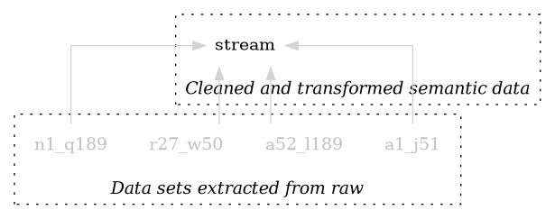

# Data architecture

The package separates source extractions from semantic datasets. The diagram shows the planned data flow:



## Source layer

Source extraction names describe the spreadsheet range they cover. For example, `a1_j51` represents cells `A1:J51`; `a52_l189` represents `A52:L189`.

Raw extractions are internal package data, available for inspection with triple-colon access, such as `blockdata:::a1_j51`. They are not part of the documented public interface. The extraction script uses the spreadsheet's first row as column names, keeps cell values as character data, and does not clean or transform the values. Thus `a1_j51` contains rows 2–51 as data with row 1 as its column names; `a52_l189` contains rows 52–189 with column names taken from row 1.

## Semantic layer

Semantic datasets are named for their grain; e.g., `stream` indicates a dataset of one row per stream. The planned `stream` dataset is cleaned and transformed from the source extractions and will be available through the public package interface as `blockdata::stream`. pkgdown documentation should focus on these semantic datasets.

The initial package work covers the package scaffold and source extraction datasets. The semantic `stream` dataset is a later step.

## Regenerate the diagram

The diagram source is [`data-lineage.dot`](data-lineage.dot). With [Graphviz](https://graphviz.org/download/) installed, run the converter from the repository root:

```sh
bash data-architecture/render-diagram.sh
```

This writes `data-architecture.png` beside the DOT source.
